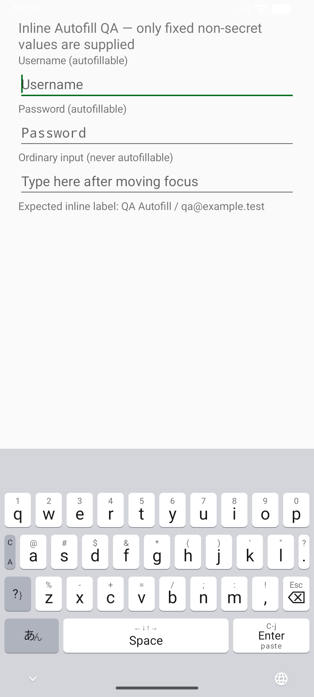
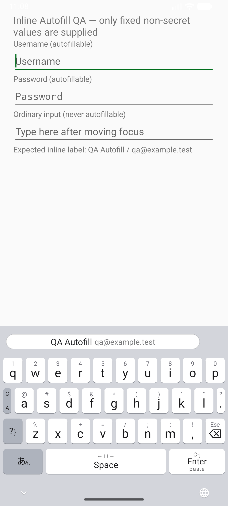
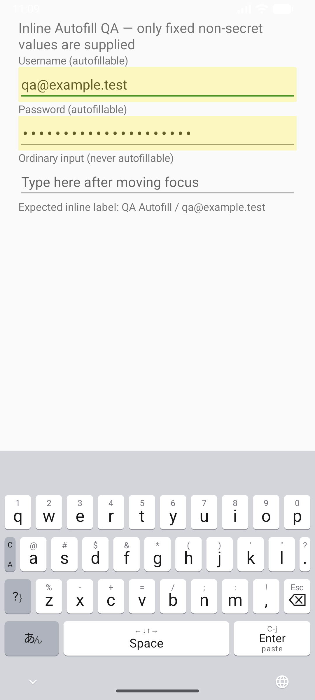

# Bitwarden インライン自動入力 — 人間レビュー

## 決定サマリー

Bitwardenを使う人がキーボードを切り替えず、ログイン欄の自動入力候補を選べるようにするための変更です。

- **実測**: Android API 36.1のエミュレータで検証用自動入力サービスを使い、masuidrive-kbdの候補欄に候補が出て、タップでユーザー名とパスワードの両方がAndroidの自動入力から入りました。エミュレータの幅を411dpと840dpにして候補表示を確認しました。物理端末・実タブレットの結果ではありません。
- **利用者の実機確認**: Bitwardenの候補表示をInlineへ切り替えると、Chromeのログイン欄でmd-kbdの候補帯にBitwarden候補2件が表示されました。候補タップ後の入力結果はまだ未報告です。画像には個人の会員番号があるため、この資料へ複製しません。
- **未確認**: Bitwarden本体の候補選択後の入力、Android 9・10の入力とポップアップ表示です。Bitwardenにログイン済みの接続端末がなく、旧OSの検証環境もありません。検証用サービスをBitwarden本体の選択動作の証拠とは扱いません。
- **確定判断**: 標準Android APIを使う、既存の50dp候補欄に表示する、認証情報をIMEで読まない、という3点をそのまま実装しました。
- **保存される形**: 変更なし。設定値、辞書、データベースを増やしていません。
- **外部から見える契約**: Android 11以降の自動入力サービスがIMEへインライン候補を渡せる宣言・callbackを追加しました。従来のキー入力操作は変更していません。

## 出来上がりの像

ログイン欄で自動入力サービスから候補が届くと、キーボード上端にそのサービスの候補が出ます。タップはAndroidの自動入力へ渡し、IMEがユーザー名やパスワードの文字列を追加送信しません。

同じ検証用サービス・411dpの修正前試験版では候補欄が空白でした。修正後は候補が出て、選択すると両欄が埋まります。画像の `QA Autofill` は固定テスト値を返す検証用サービスで、Bitwardenの画面ではありません。

| 修正前試験版 | 修正後 | 選択後 |
|---|---|---|
|  |  |  |

840dpの表示は[Tablet相当の画像](evidence/tablet-inline.png)、候補がない通常欄の入力は[通常欄にqを入力した画像](evidence/ordinary-q.png)で確認できます。

利用者の実Bitwarden画像では、インライン候補は正しく出ましたが、ダークキーボード上でAndroidX既定の白い候補面が目立ちました。IMEが候補の保護内容を読まずにAndroidX v1の表示styleだけを指定し、通常候補と同じ暗色面・明色文字に揃えました。[暗色の411dp相当](evidence/inline-dark-themed.png)と[明色の411dp相当](evidence/inline-light-wide.png)は固定QA値のAndroid AutofillServiceによる表示で、Bitwarden本体の新しい色を実機で見た証拠ではありません。

## 受け入れ条件ごとの達成

| 条件 | 判定と証拠 |
|---|---|
| 利用者がBitwardenでインライン表示を有効にし、対応するログイン欄を開くと、提供された自動入力候補がキーボードの候補欄に表示される。 | **実Bitwardenで表示を確認**。利用者の実機画像でChromeのログイン欄とmd-kbd候補帯の候補2件を確認。QAサービスの候補も411dp・840dpで表示。 |
| 利用者がその候補をタップするとAndroidの自動入力経由でログイン欄が埋まり、IMEが候補文字列を別途入力しない。 | **部分的に確認**。QA候補の実タップで2欄が埋まり、重複なし。Bitwarden候補のタップは未確認。 |
| 利用者が入力欄を切り替えるか候補がなくなると、前の欄の自動入力候補は消える。通常の文字・変換候補が必要な欄では引き続き選択できる。 | **確認済み**。通常欄へ移るとQA候補が消え、md-kbdの実キーで文字が入力できた。通常候補への置換と日本語候補の選択イベントは`CandidateStripViewTest`、空応答・失敗・古いcallbackは単体テストで確認。日本語変換候補の選択をQAサービス利用直後に実操作した証拠はありません。 |
| Android 9・10の利用者は従来どおり文字を入力でき、Bitwardenが使うAndroidのポップアップ自動入力をIMEが妨げない。Android 11以降でも自動入力候補が届かない欄では従来どおり文字を入力できる。 | **部分的に確認**。API28/29ではinline APIを使わないコード・単体テストと、Android API 36.1の候補なし欄での実キー入力を確認。Android 9・10実OSとBitwardenのポップアップは未確認。 |

## 返す

**判断: Bitwarden本体の候補タップ後の入力と旧OSの実画面を未確認のまま、この達成でチケットを閉じてよいですか。** 推奨は、少なくともBitwarden本体で候補をタップして入力結果を確認してから閉じることです。利用者の公開承認を受け、v0.15.32 APKと製品ページは公開済みです。公開承認は、このチケットを閉じる承認とは区別しています。

- **A: いったん閉じず、Bitwardenで手動確認する（推奨）**。得るもの: この依頼の中心であるBitwardenとの組み合わせを確かめられます。公開版を試した結果が出るまでチケットは開いたままです。結果を受けたら、旧OSの未確認を残してよいかも同時に判断します。
- **B: 未確認を明示して閉じる**。得るもの: 公開済みの変更を、未確認項目を明示したままチケットとして閉じられます。失うもの: Bitwarden本体とAndroid 9・10の動作には未確認のリスクが残ります。実際に候補が出ない、タップで埋まらない、旧OSでポップアップが出ない場合はこの判断を撤回して修正が必要です。
- **C: 修正指示を返す**。得るもの: 公開前に追加の条件を反映できます。公開済みv0.15.32の修正が必要なら次の版で対応します。

回答: **A / B / C** と、必要なら一言ください。Aの場合はレビュー用APKをAndroid端末へ転送してBitwardenを自動入力サービスに指定し、Bitwardenの表示方式をInlineにしてログイン欄で候補を選んでください。公開APKは https://github.com/masuidrive/android-kbd/releases/tag/v0.15.32 から直接取得できます。

---

ここから先は、判断のために読む必要はありません。

## 裏付け

### 差分の規模と戻し方

IME service・候補View・IME宣言・テスト・マニュアルを主に追加しました。永続データの形、ネットワーク権限、Bitwarden保管庫への接続は変更していません。v0.15.32は公開済みです。公開後に不具合が出た場合は旧APKへ戻せますが、既に入力先へ確定した文字は戻りません。

### テストと画面確認

**全スイートが通過し、suite内の失敗・skipはありません。** `scripts/test-all.sh --parallel --connected` の出力:

```text
PASS: fast-checks
PASS: android unit, lint, apk
PASS: android connected (real Mozc)
Passed: 3 / 3
```

恒久テストは単体325件、Android接続30件で失敗・skip 0。Android 11の空の追加情報でもrequestを作ること、保護Viewの実寸保持、古いcallbackの破棄、全候補描画失敗時の復帰を含みます。一時確認はQA用Android AutofillServiceでの候補表示・タップ入力・欄切替と、411dp/840dpのスクリーンショットです。実BitwardenとAndroid 9・10の一時確認はありません。

公開版の最終テスト対象は`d64a78374a8314f26eb3390b962602dafedbb459`、実行環境はAndroid API 36.1エミュレータです。初回の並列実行はAPK生成競合で接続試験のインストールが失敗し、0件のまま終了しました。同じSHAの再実行は3/3 PASSです。候補表示・tapの画像を採取した実装SHAは`3909a6f3b0db9f93b73725eb567e655cb0b7229c`です。公開版では候補色とバージョンが後続のSHAで更新されています。通常欄の`q`画像とUI情報は`b00318a`で採取しました。

独立レビューのCritical 2件・Major 1件は修正し、修正差分の再レビューで解消済みです。**直さなかったレビュー指摘は0件**です。Bitwardenと旧OSの未確認はレビュー指摘を修正せず残したものではなく、検証環境がない条件です。

### 自分で確かめる手順

1. Android 11以降の端末へ上記レビュー用APKを転送してインストールし、masuidrive-kbdをIMEに設定します。
2. Bitwardenを端末の自動入力サービスに選び、Bitwardenの「自動入力」で候補の表示方式をInlineにします。Chrome/Braveで試す場合はBitwarden側のブラウザ連携も有効にします。
3. Bitwardenに保存済みのログイン欄を開き、キーボード上端に候補が出ること、候補をタップするとユーザー名・パスワードが一度だけ入ることを確認します。
4. ほかの通常欄へ移り、古い候補が消えて通常のキー入力ができることを確認します。
5. Android 9・10端末があれば、通常入力とBitwardenのポップアップ候補も確認します。端末がなければ、この部分は未確認のままとして回答に含めてください。

Androidの仕様は[IMEと自動入力の統合](https://developer.android.com/identity/autofill/ime-autofill)、Bitwardenの設定は[Bitwarden Android Autofill](https://bitwarden.com/help/auto-fill-android/)を参照しました。
